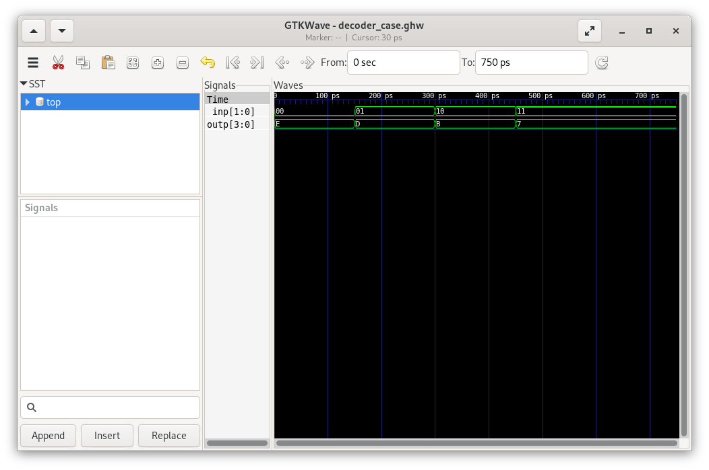

# Assignment 2 — Combinational Decoder in VHDL

An exercise implementing a two-input, four-output decoder using two VHDL description styles: a `case` statement and a `with … select` assignment.

Completed as part of **IN3160 – Digital System Design** at the University of Oslo.

The original assignment description is unavailable. This overview is based on the archived source files, testbenches and waveform screenshot.

## Overview

The implementation separates the decoder interface from its behaviour:
- One entity declaration defines the input and output ports.
- Two alternative architecture files describe the same decoding behaviour.
- Separate cocotb testbenches apply all four binary input combinations.
- A makefile selects the implementation and testbench for simulation.

## Decoder Behaviour

The decoder has a two-bit input, `inp`, and a four-bit output, `outp`.

For each binary input, one output bit is low while the remaining bits are high:

| Input `inp` | Output `outp` | Selected output bit |
| --- | --- | --- |
| `00` | `1110` | Bit 0 |
| `01` | `1101` | Bit 1 |
| `10` | `1011` | Bit 2 |
| `11` | `0111` | Bit 3 |

Both implementations assign `0000` through their `others` branch for input combinations outside these four binary patterns.

The decoder is combinational and has no clock or reset.

## Implementations

### Case Statement

[`src/decoder_case.vhd`](src/decoder_case.vhd) describes the output mapping using a `case` statement inside a process sensitive to `inp`.

### Selected Assignment

[`src/decoder_select.vhd`](src/decoder_select.vhd) describes the same mapping using `with inp select` inside a process sensitive to `inp`.

### Shared Entity

[`src/decoder_ent.vhd`](src/decoder_ent.vhd) defines the shared `decoder` entity.

Both alternative architecture files declare an architecture named `RTL`. The makefile selects one architecture file at a time; it does not select between uniquely named architectures compiled together.

## Files

| Path | Purpose |
| --- | --- |
| [`src/decoder_ent.vhd`](src/decoder_ent.vhd) | Shared decoder entity |
| [`src/decoder_case.vhd`](src/decoder_case.vhd) | Implementation using `case` |
| [`src/decoder_select.vhd`](src/decoder_select.vhd) | Implementation using `with … select` |
| [`test/tb_decoder_case.py`](test/tb_decoder_case.py) | Testbench for the case implementation |
| [`test/tb_decoder_select.py`](test/tb_decoder_select.py) | Testbench for the selected-assignment implementation |
| [`test/`](test/) | Simulation makefile and testbenches |
| [`wave1.png`](wave1.png) | Archived waveform screenshot |

## Simulation and Testing

Each testbench applies the four binary input combinations in sequence, waiting 150 ns after each change before evaluating the output.

The testbenches include intended checks against the decoder truth table. However, the archived assertions enclose the condition and message together in parentheses. This tuple-style assertion must be corrected before the tests can be relied upon to detect incorrect outputs.

The tests do not exercise nonbinary input values or check the `others` branch.

## Running the Simulation

### Requirements

The supplied configuration uses:
- Python with cocotb
- GHDL
- GNU Make
- VHDL-2008 support
- Optionally, GTKWave for waveform inspection

The original tool versions have not been recorded. The commands below have not yet been reverified in a clean environment.

### Prepare the Makefile

Place the supplied simulation configuration in `test/` and name it `Makefile`.

The configuration expects the VHDL files in `../src/` relative to the test directory.

### Run the Case Implementation

From the repository root:

```bash
cd assignment2/test
make ARCHITECTURE=case
```

### Run the Selected-Assignment Implementation

Clean the previous build before switching implementations:

```bash
make clean
make ARCHITECTURE=select
```

Cleaning between runs avoids reusing build output from the other implementation.

### Inspect the Waveform

The supplied configuration requests a waveform file named `decoder.ghw`.

If GTKWave is installed:

```bash
gtkwave decoder.ghw
```

Both implementations use the same waveform filename. Save or rename the file before the next simulation if you want to retain separate results.

### Tool Compatibility

The archived makefile and testbenches use older cocotb conventions. Compatibility with the installed cocotb version should be checked before running.

## Archived Waveform



The screenshot shows the expected output sequence for the four binary input combinations. The hexadecimal output values `E`, `D`, `B` and `7` correspond to `1110`, `1101`, `1011` and `0111`.

This image is evidence of an archived simulation trace, not a substitute for a rerun with functioning automated checks.

The screenshot's displayed time scale also differs from the nanosecond delays in the supplied Python testbenches. Its timing should not be treated as a verified match to the current source files.

## Context and Contribution

The files are archived coursework submissions. The original task description is unavailable, and the division between provided resources and personal implementation has not yet been documented.

## Limitations and Further Work

- Correct the assertion syntax in both testbenches.
- Confirm that deliberately incorrect output expectations cause the tests to fail.
- Rerun both implementations and record the tool versions and results.
- Exercise the nonbinary-input behaviour where supported.
- Reconcile the archived waveform timing with the supplied testbenches.
- Document provided code and personal contributions.

## Topics Practised

- Separating VHDL entity and architecture declarations
- Describing combinational logic using alternative language constructs
- Implementing an active-low decoder
- Applying test inputs with cocotb
- Inspecting simulation waveforms
- Configuring alternative source files through a makefile
