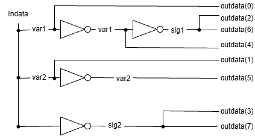

# Assignment 3 — Signals, Variables and Process Sensitivity

A learning exercise completed during my degree as part of **IN3160 – Digital System Design** at the **University of Oslo**.

This assignment explored how variables, signals and process sensitivity lists affect VHDL simulation behaviour. It combined simulation, written explanations and a diagram created in draw.io.

> **Archived coursework with a corrected diagram**
>
> The original code and written answers are preserved and reflect my
> understanding at the time. They contain mistakes discussed below.
>
> The mistakes in the original illustration for part c have been corrected.
> The replacement diagram is available as `newdiagram.darwio.png`; the
> original `3c.drawio.png` has been removed.
>
> This diagram correction does not mean that the archived code or written
> answers have been revised or fully verified.

## Assignment Overview

The exercise was divided into four parts:

| Part | Focus |
| --- | --- |
| a | Simulate a clocked design and explain its output timing |
| b | Replace variables with signals and investigate the resulting behaviour |
| c | Compare variable and signal assignments and draw a conceptual diagram |
| d | Modify a process sensitivity list and explain the effect on simulation |

The original instructions are available in the
[assignment description](taskdescription.md).

## Repository Contents

| Path | Description |
| --- | --- |
| [`src/`](src/) | Archived VHDL source files |
| [`test/`](test/) | Archived testbenches and simulation configuration |
| [`tasks.md`](tasks.md) | My original written answers |
| [`newdiagram.darwio.png`](newdiagram.drawio.png) | Corrected draw.io illustration for part c |
| [`taskdescription.md`](taskdescription.md) | Original course-provided assignment instructions |
| [`tasks_tmp.html`](tasks_tmp.html) | Additional archived HTML file |

## My Work

My contribution included the written explanations in `tasks.md` and
the draw.io illustration for part c. The exercise also involved modifying
and simulating the supplied examples.

This was coursework based on provided material, rather than an
independently designed FPGA system. The precise division between starter
code and my modifications is not fully documented in this archive.

The illustration for part c was subsequently reviewed against the VHDL
source and corrected.

## Corrected Illustration

This diagram replaces the original `3c.drawio.png`. The corrections include:

- Adding inversion bubbles to the inverter symbols.
- Showing variable values before and after their immediate updates.
- Placing each internal signal on one shared node.
- Connecting `outdata(2)` and `outdata(6)` to the same `sig1` node.
- Connecting `outdata(3)` and `outdata(7)` to the same `sig2` node.
- Clarifying wire branches and output connections.

The diagram shows the logical structure before synthesis optimisation.
It does not represent delta-cycle timing or imply physical propagation
delays.

The final assignments to `sig1` and `sig2` supersede their earlier
assignments within the same process execution. Consequently, the diagram
shows `sig1` after two inversions of `indata` and `sig2` after one inversion.

## Retrospective — What I Now Recognise

### Explaining signal and variable updates

My original answers describe some timing differences as assignments
“taking longer.” This was not a sufficiently precise explanation.

A better explanation would distinguish:

- Immediate updates to variables within a process
- Scheduled updates to signals
- Delta cycles, which do not themselves advance simulation time
- Clock-cycle delays introduced by the structure of a clocked design

Today, I would trace the values read and assigned during each process
execution rather than explain the behaviour as a general difference
in assignment speed.

### Timing units and input values

My written answers use picoseconds, while the assignment instructions
specify nanoseconds. The archived testbench input patterns also need
to be checked against the requested values.

I would now report timings directly from the relevant simulation and
check that the source, waveform and written explanation describe
the same experiment.

### Unknown values

My explanation of the initial `UUUUUUUU` output was too broad.

I would now identify which internal signals were uninitialised,
when reset took effect and how those values propagated through the
design, rather than attribute the result only to the input.

### Diagram notation and connections — corrected

The original drawing omitted inverter output bubbles and did not
correctly show the relationship between the variable values, signal
nodes and output connections.

These mistakes have been addressed in
[`newdiagram.darwio.png`](newdiagram.darwio.png).

The corrected diagram distinguishes intermediate variable values from
signal nodes. Variables are labelled at multiple points to show their
values before and after reassignment, while each signal is labelled on
one shared wire that branches to its corresponding outputs.

This also makes clear why both output pairs read the same signal values:

- `outdata(3 downto 2)` reads `sig2 & sig1`.
- `outdata(7 downto 6)` also reads `sig2 & sig1`.

Signal assignments do not update those values midway through the process
execution.

### Process sensitivity

My explanation of part d could more clearly separate:

- The process execution at simulation startup
- Later executions triggered by sensitivity-list events
- Signal updates that no longer trigger the process after a signal
  is removed from that list

I would also preserve the different experimental versions separately,
making it easier to connect each explanation to the code that produced
the observation.

## What I Would Do Differently

If repeating the exercise, I would:

1. Keep a separate source version for each part.
2. Check the input patterns and timing units against the instructions.
3. Use a table to trace values across process executions and clock edges.
4. Save labelled waveforms alongside the corresponding source version.
5. Add automated output checks where appropriate.
6. Validate the diagram against the VHDL statement by statement.
7. Clearly separate observed behaviour from my explanation of its cause.

The diagram review and correction have been applied. The other items
remain retrospective improvements, not changes applied to the archived
code or written answers.

## Learning Value

This exercise helped introduce the distinction between writing
sequential-looking VHDL statements and understanding their simulation
semantics.

Revisiting the submission also shows the importance of precise technical
explanations: observing an output change is not the same as correctly
explaining why it changed.

Correcting the diagram reinforced the difference between immediate
variable updates and scheduled signal updates, and the importance of
checking each connection against the source code.

## Verification Status

The files are presented as a historical learning exercise, not as a
validated reference implementation.

The diagram for part c has been reviewed against the supplied VHDL code
and corrected. The original illustration has been replaced by
[`newdiagram.darwio.png`](newdiagram.darwio.png).

The simulations have not been rerun as part of this documentation update.
The archived code and original written answers remain unchanged,
including the limitations discussed above.
